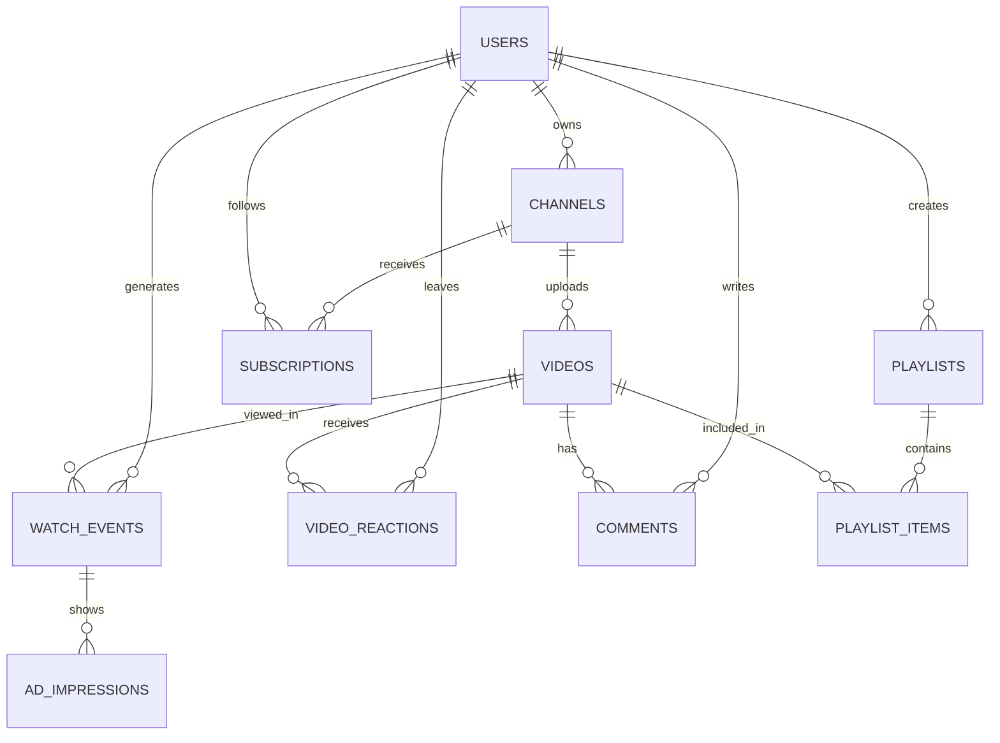

# Phase 2: Schema Design and Data Loading

## 1. Data Dictionary

### Core Entities
| Table | Column | Type | Constraint | Why |
| :--- | :--- | :--- | :--- | :--- |
| **users** | `user_id` | INT | PRIMARY KEY | Unique identifier for each user. |
| | `email` | VARCHAR | UNIQUE, NOT NULL | Must be unique; login credential. |
| | `display_name` | VARCHAR | NOT NULL | User's public facing name. |
| | `country_code` | CHAR(2) | CHECK length=2 | Standardizes location to 2 letters. |
| | `birth_year` | INT | CHECK bounds | Ensures age is mathematically valid. |
| | `premium_until` | DATE | NULLABLE | Null if not premium; dates track subscription expiry. |
| | `created_at` | TIMESTAMPTZ | NOT NULL | Account creation timestamp. |
| **channels** | `channel_id` | INT | PRIMARY KEY | Unique identifier for creators. |
| | `owner_user_id` | INT | FK -> users | Connects the channel to its owning user. |
| | `handle` | VARCHAR | UNIQUE, NOT NULL | `@` handles must be unique per platform rules. |
| | `channel_name` | VARCHAR | NOT NULL | Display name of the channel. |
| | `country_code` | CHAR(2) | CHECK length=2 | 2-letter country code. |
| | `is_verified` | BOOLEAN | NOT NULL | Indicates official verification status. |
| | `monetization_status`| VARCHAR | CHECK (IN) | Must be 'ELIGIBLE', 'NOT_ELIGIBLE', or 'SUSPENDED'. |
| | `subscriber_count` | INT | CHECK (>= 0) | Denormalized count, cannot be negative. |
| | `created_at` | TIMESTAMPTZ | NOT NULL | Timestamp of channel creation. |
| **videos** | `video_id` | VARCHAR(11) | PRIMARY KEY | 11-char YouTube-style string ID. |
| | `channel_id` | INT | FK -> channels | Links video to its creator. |
| | `title` | VARCHAR | NOT NULL | Video title. |
| | `description` | TEXT | NULLABLE | Video description. |
| | `category` | VARCHAR | NOT NULL | Video content category (e.g., Education). |
| | `duration_sec` | INT | CHECK (>= 0) | Video length cannot be negative. |
| | `is_short` | BOOLEAN | NOT NULL | Flags if the video is a YouTube Short. |
| | `is_made_for_kids`| BOOLEAN | NOT NULL | COPPA compliance flag. |
| | `visibility` | VARCHAR | CHECK (IN) | Enforces 'PUBLIC', 'PRIVATE', 'UNLISTED', 'SCHEDULED'. |
| | `uploaded_at` | TIMESTAMPTZ | NOT NULL | Internal upload timestamp. |
| | `published_at` | TIMESTAMPTZ | NULLABLE | Null if private/unlisted. |
| | `view_count` | INT | CHECK (>= 0) | Denormalized view count. |

### User Interactions
| Table | Column | Type | Constraint | Why |
| :--- | :--- | :--- | :--- | :--- |
| **subscriptions**| `user_id, channel_id`| Composite PK | PRIMARY KEY | A user can only subscribe to a specific channel once. |
| | `notifications` | VARCHAR | CHECK (IN) | Notification preference ('ALL', 'NONE', etc). |
| | `subscribed_at` | TIMESTAMPTZ | NOT NULL | When the subscription occurred. |
| **watch_events** | `watch_id` | INT | PRIMARY KEY | Tracks individual viewing sessions. |
| | `user_id` | INT | FK -> users | The user who watched (can be null if logged out). |
| | `video_id` | VARCHAR(11) | FK -> videos | Identifies what was watched. |
| | `started_at` | TIMESTAMPTZ | NOT NULL | Timestamp of view start. |
| | `watch_seconds` | INT | CHECK (>= 0) | Cannot watch negative time. |
| | `device` | VARCHAR | NOT NULL | E.g., 'MOBILE', 'DESKTOP'. |
| | `traffic_source` | VARCHAR | NOT NULL | E.g., 'HOME', 'SEARCH'. |
| **video_reactions**| `user_id, video_id` | Composite PK | PRIMARY KEY | One reaction (like/dislike) per user per video. |
| | `reaction` | VARCHAR | CHECK (IN) | Must be 'LIKE' or 'DISLIKE'. |
| | `reacted_at` | TIMESTAMPTZ | NOT NULL | Timestamp of reaction. |
| **comments** | `comment_id` | INT | PRIMARY KEY | Unique ID for the comment. |
| | `video_id` | VARCHAR(11) | FK -> videos | Video the comment belongs to. |
| | `user_id` | INT | FK -> users | Author of the comment. |
| | `parent_comment_id`| INT | FK -> comments | Self-referencing FK for replies. |
| | `body` | TEXT | NOT NULL | The comment text. |
| | `like_count` | INT | CHECK (>= 0) | Denormalized like count. |
| | `is_pinned` | BOOLEAN | NOT NULL | If the creator pinned it. |
| | `created_at` | TIMESTAMPTZ | NOT NULL | Comment timestamp. |

### Collections & Monetization
| Table | Column | Type | Constraint | Why |
| :--- | :--- | :--- | :--- | :--- |
| **playlists** | `playlist_id` | INT | PRIMARY KEY | Unique ID for the playlist. |
| | `owner_user_id` | INT | FK -> users | Owner of the playlist. |
| | `title` | VARCHAR | NOT NULL | Playlist name. |
| | `visibility` | VARCHAR | CHECK (IN) | 'PUBLIC', 'PRIVATE', 'UNLISTED'. |
| | `created_at` | TIMESTAMPTZ | NOT NULL | Creation timestamp. |
| **playlist_items** | `playlist_id, position`| Composite PK | PRIMARY KEY | Controls the exact ordering in a playlist. |
| | `video_id` | VARCHAR(11) | FK -> videos | The video being added. |
| | `added_at` | TIMESTAMPTZ | NOT NULL | When it was added. |
| **ad_impressions** | `impression_id` | INT | PRIMARY KEY | Unique ad view identifier. |
| | `watch_id` | INT | FK -> watch_events | The view session during which the ad showed. |
| | `ad_format` | VARCHAR | NOT NULL | E.g., 'PREROLL', 'MIDROLL'. |
| | `revenue_inr` | DECIMAL(10,4)| CHECK (>= 0) | Ad revenue generated. |
| | `shown_at` | TIMESTAMPTZ | NOT NULL | Timestamp the ad appeared. |

## 2. Entity-Relationship (ER) Diagram

## 3. Functional Dependencies and Normal Forms
The database is designed in **Third Normal Form (3NF) / BCNF**. Every non-key attribute depends strictly on the primary key, and there are no transitive dependencies.
*   **users:** `user_id` → `email, display_name, country_code, birth_year, premium_until, created_at`
*   **channels:** `channel_id` → `owner_user_id, handle, channel_name, country_code, is_verified, monetization_status, subscriber_count, created_at`
*   **videos:** `video_id` → `channel_id, title, description, category, duration_sec, is_short, is_made_for_kids, visibility, uploaded_at, published_at, view_count`
*   **subscriptions:** `{user_id, channel_id}` → `notifications, subscribed_at`
*   **watch_events:** `watch_id` → `user_id, video_id, started_at, watch_seconds, device, traffic_source`
*   **video_reactions:** `{user_id, video_id}` → `reaction, reacted_at`
*   **comments:** `comment_id` → `video_id, user_id, parent_comment_id, body, like_count, is_pinned, created_at`
*   **playlists:** `playlist_id` → `owner_user_id, title, visibility, created_at`
*   **playlist_items:** `{playlist_id, position}` → `video_id, added_at`
*   **ad_impressions:** `impression_id` → `watch_id, ad_format, revenue_inr, shown_at`

### Derived and Redundant Columns
While the schema adheres to 3NF logic, the following derived columns were intentionally retained (denormalized) to optimize performance for a read-heavy workload:
*   **`channels.subscriber_count`:** Redundant because it can be calculated by aggregating the `subscriptions` table. Justified because calculating this dynamically for every channel page load would be too expensive.
*   **`videos.view_count`:** Redundant as it can be derived by counting `watch_events`. Justified because view counts are displayed on almost every UI surface (search, trending, watch page).
*   **`videos.is_short`:** Redundant because it strictly correlates with `duration_sec <= 60`. Justified because it serves as a business logic flag for the Shorts shelf, preventing the need to evaluate math constraints during simple UI filtering.

## 4. Data Problems Found & Resolved
During the initial CSV loading phase (`\copy`), the following data integrity issues were discovered:
1.  **Constraint Violation on Channels:** The `channels.csv` file contained a row (Pooja Kitchen, channel_id 18) where the `monetization_status` was set to `"SUSPENDED"`. The original schema only permitted `"ELIGIBLE"` and `"NOT_ELIGIBLE"`.
2.  **Cascading Foreign Key Failures:** Because the `channels` row failed to insert, every subsequent file (`videos`, `subscriptions`, `comments`, etc.) that referenced `channel_id = 18` or its associated videos was rejected by PostgreSQL due to cascading Foreign Key constraint violations.
3.  **Resolution:** Modified the `CHECK` constraint in `sql/01_schema.sql` to explicitly include `'SUSPENDED'`. Dropping and recreating the schema with this updated constraint allowed all 10 CSV files and their relational dependencies to load perfectly with zero errors.

## 5. Integrity Check Results
All logical checks returned 0 rows, confirming data integrity:
1.  **Time-travel anomaly** (Watch event before video upload): 0 rows.
2.  **Duplicate entry** (Same video in the same playlist twice): 0 rows.
3.  **Privacy violation** (Private video with a published_at timestamp): 0 rows.